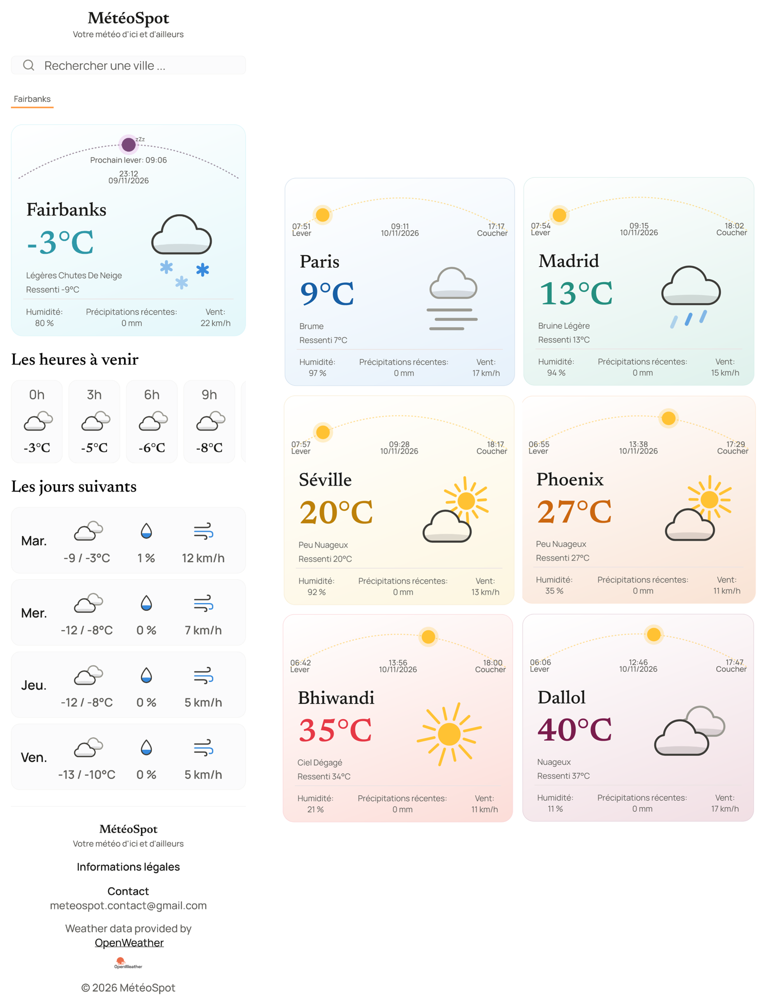

# MétéoSpot 

---

MétéoSpot est une application météo mobile-first, développée en HTML, CSS et JavaScript vanilla.

**Site en ligne :** https://charlottequentin-froignant.github.io/meteospot/



*Vue d'ensemble de l'application et de chaque palier de température au 10 novembre 2026*

---

## Fonctionnalités

- Météo actuelle
- Prévisions des prochaines heures (1 point toutes les 3h)
- Prévisions des 4 prochains jours
- Recherche d'une ville
- Géolocalisation
- Onglets des villes recherchées conservés dans le navigateur
- Palette de couleurs qui varie selon la température
- Gestion des états : bienvenue, localisation désactivée, erreur de l'API

---

## Contexte

Ce projet part d'un exercice de ma formation CDA (Concepteur Développeur d'Applications) portant sur la manipulation du DOM et les appels API fetch. Le périmètre initial étant limité, j'ai choisi d'en faire un vrai projet personnel complet avec un design, un backlog structuré et un workflow git, pour développer une petite application de A à Z et la déployer, plutôt que de coder une fonctionnalité isolée.

Ce travail est réalisé en dehors des heures de formation, avec une disponibilité variable selon la charge des cours.

---

## Stack technique

- HTML5, CSS3 et JavaScript vanilla.
- API météo : [OpenWeather](https://openweathermap.org/) (offre gratuite avec météo actuelle et prévisions sur 5 jours avec un pas de 3h).
- Aucun framework JavaScript ni librairie CSS : choix volontaire pour comprendre le DOM et le CSS en profondeur avant d'utiliser des outils plus automatisés.
- Tests unitaires avec le lanceur intégré à Node (node --test), sans dépendance.

---

## Architecture du projet

```plaintext
meteospot/
├── .github/
│   └── workflows/
│       └── deploy.yml         # tests unitaires puis déploiement sur GitHub Pages
├── index.html
├── css/
│   └── style.css
├── js/
│   ├── main.js            # orchestration : événements, enchaînement des appels
│   ├── api.js             # construction des URL et requêtes (fetch), sans accès au DOM
│   ├── ui.js              # tout ce qui touche au DOM (cartes, arc solaire, onglets)
│   ├── utils.js           # fonctions pures (icônes, heures locales, arc, palette)
│   ├── config.js          # clé API personnelle (ignoré par Git)
│   └── config.example.js  # modèle de config.js, versionné
├── partials/
│   └── legal.html         # contenu des informations légales
├── tests/
│   └── palette.test.js    # tests unitaires de la palette de température
├── assets/
│   ├── favicon.ico
│   ├── fonts/             # Newsreader et Manrope, avec leurs licences (OFL)
│   ├── icons/
│   │   ├── static/        # icônes des listes de prévisions
│   │   └── animated/      # icônes animées de la météo actuelle
│   └── images/            # logo OpenWeather
├── docs/
│   ├── apercu.png         # aperçu affiché en tête du README
│   ├── design/
│   │   ├── process.md          # historique de la conception (maquettes anciennes)
│   │   ├── design-system.md    # référence actuelle (palette, typographie, icônes)
│   │   └── archive/            # ancienne version du design system
│   └── progress/               # journal de progression en captures
├── package.json
├── LICENSE
├── README.md
└── .gitignore
```

Le code est organisé selon une architecture modulaire afin de séparer les responsabilités. Chaque fichier JavaScript a ainsi un rôle unique afin de rendre le projet plus lisible, plus facile à tester et à faire évoluer.

---

## Installation et tests

### Installer le projet

1. Cloner le projet :
   ```bash
   git clone https://github.com/CharlotteQuentin-Froignant/meteospot
   cd meteospot
   ```
2. Créer une clé API gratuite sur [openweathermap.org](https://openweathermap.org/).
3. Copier le fichier de configuration et y renseigner la clé :
   ```bash
   cp js/config.example.js js/config.js
   ```
   ```js
   // js/config.js
   export const APIKEY = "votre_cle_ici";
   ```
4. Lancer l'app avec un serveur local (ex : extension **Live Server** de VS Code, clic droit sur `index.html` → *Open with Live Server*).

**Remarques :**
- `js/config.js` est ignoré par Git et ne doit jamais être commité.
- Les modules ES et la géolocalisation nécessitent un serveur local ou HTTPS : l'ouverture directe de `index.html` ne fonctionne pas.
- Sans backend, la clé reste visible côté client (limite assumée pour ce projet d'apprentissage).

### Lancer les tests unitaires

Le lancement des tests unitaires s'effectue par la ligne de commande `npm test`.

---

## Déploiement

Le site est publié sur GitHub Pages grâce à un workflow GitHub Actions ([`.github/workflows/deploy.yml`](.github/workflows/deploy.yml)), lancé à chaque push sur la branche `main` ou manuellement.

Le workflow se déroule en deux étapes :

- **Tests** : installation de Node 24, puis `npm test`. Si un test échoue, rien n'est déployé ;
- **Déploiement** : seuls `index.html`, `css/`, `js/`, `assets/` et `partials/` sont copiés dans le dossier publié. La documentation, les tests et les autres fichiers du dépôt restent hors ligne.

La clé d'API n'est jamais versionnée : `js/config.js` est généré pendant le déploiement à partir d'un secret du dépôt (`OPENWEATHER_API_KEY`).

---

## Méthode

Travaillant seule et avec une disponibilité réduite, je n'ai pas retenu la notion de sprint, mais j'ai plutôt adapté deux outils agiles à mon contexte :

- Backlog priorisé sur GitHub Projects, avec un rétroplanning par ticket (date de début/fin propre à chaque tâche) ([voir le projet](https://github.com/users/CharlotteQuentin-Froignant/projects/1)).
- Priorisation MoSCoW pour trancher ce qui est indispensable de ce qui est accessoire. Etablie au départ du projet, avec l'état d'avancement au 10 novembre 2026.

<details>
<summary>Voir le détail du MoSCoW</summary>

**Must have** (indispensable)

| Fonctionnalité | État |
|---|---|
| Barre de recherche | Fait |
| Météo actuelle | Fait |
| Prévisions des prochaines heures | Fait |
| Design mobile-first | Fait |

**Should have** (important)

| Fonctionnalité | État |
|---|---|
| Arc lever/coucher du soleil | Fait |
| Icônes météo cohérentes et distinctes selon les conditions | Fait |
| Géolocalisation | Fait |
| Gestion des états (erreur API, bienvenue, localisation désactivée) | Fait |
| Prévisions sur 4 jours | Fait |
| Palette dynamique selon la température | Fait |
| Informations légales et attribution OpenWeather | Fait |
| Mise en page tablette (colonne mobile centrée, largeur maximale de 768 px) | Fait |

**Could have** (souhaitable)

| Fonctionnalité | État |
|---|---|
| Onglets des villes recherchées conservés dans le navigateur | Fait |
| Accessibilité : niveau WCAG 2.2 AA visé | En cours |
| Responsive desktop (pour l'instant : colonne centrée, sans disposition dédiée) | Non fait |
| Mode sombre | Non fait |

**Won't have** (pas dans cette version)

- Météo des extrêmes (sélection de villes emblématiques)
- Carte interactive
- Notifications
- Alertes météo (vigilance, etc.)

</details>

---

## Design

La maquette a été conçue par itérations successives avec l'aide de l'IA, sans passer par Figma. La direction de départ, de type dashboard bleu en glassmorphism m'a semblé trop générique. Je l'ai donc retravaillée vers une identité plus sobre : fond clair, typographies Newsreader et Manrope, palette de couleurs évolutive.

Le détail du processus de conception est décrit dans [docs/design/process.md](docs/design/process.md). Ce document est historique, car le design et l'esthétique ont évolué au cours du projet et les maquettes qu'il présente ne correspondent plus à l'application.
La référence actuelle (couleurs, typographie, icônes) est résumée dans le fichier [docs/design/design-system.md](docs/design/design-system.md).

L'application se distingue par un arc qui représente la trajectoire du soleil entre le lever et le coucher du soleil. La nuit, le soleil reste en position fixe au centre de l'arc et l'heure du prochain lever est indiquée. Egalement, la couleur du fond de la carte météo, de sa bordure et du chiffre de la température varie selon la température affichée, afin de donner une indication visuelle immédiate du ressenti climatique.

---

## Place de l'IA dans le projet

J'ai eu recours à l'IA (Claude, Anthropic) tout au long du projet, comme un "tuteur" pour comprendre de nouvelles notions, diagnostiquer et résoudre des bugs, ou comparer des options de conception. Certaines solutions m'ont été proposées par l'IA, le plus souvent avec une explication ligne par ligne afin de pouvoir bien comprendre ce que fait le code (et pourquoi) et savoir l'expliquer.

L'IA a également été utilisée pour le rendu visuel des maquettes, la création des icônes et des tests unitaires de la palette des couleurs ; ainsi que pour une grande partie de la documentation, afin d'accélérer le processus d'écriture. Toute la documentation a été relue, complétée et modifiée par mes soins avant intégration.

---

## Avancement

Un journal de suivi a été mis en place, afin d'avoir un historique d'évolution visuelle du projet selon son avancement ([voir le document](docs/progress/README.md)).

---

## Crédits

- Données météo : [OpenWeather](https://openweathermap.org/)
- Polices : Newsreader et Manrope, sous licence SIL Open Font License 1.1 (licences dans assets/fonts/).
- Icônes et maquettes : créées par itérations avec Claude (Anthropic).

---

## Licence
Le code est publié sous licence MIT (voir LICENSE).
Les polices conservent leur propre licence, et le logo reste la propriété d'OpenWeather.