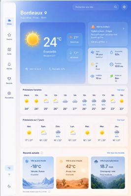
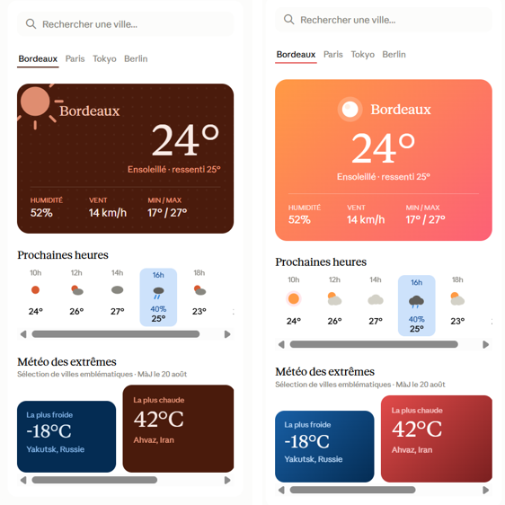
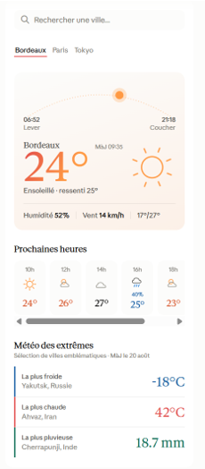
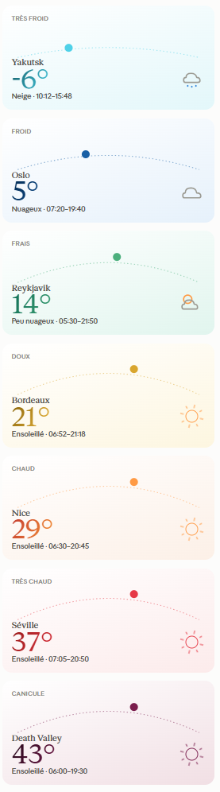
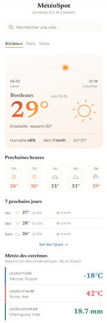
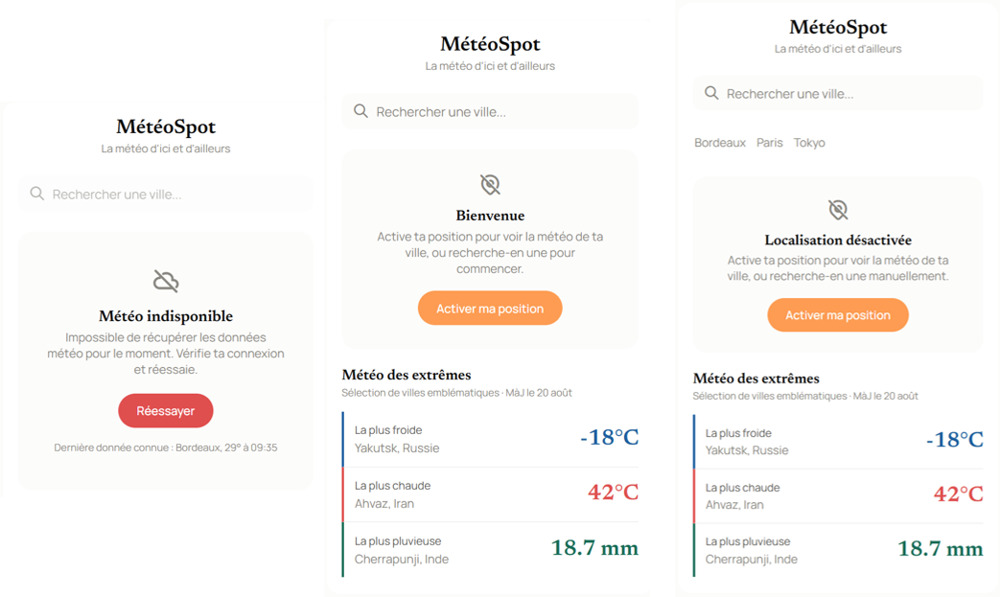
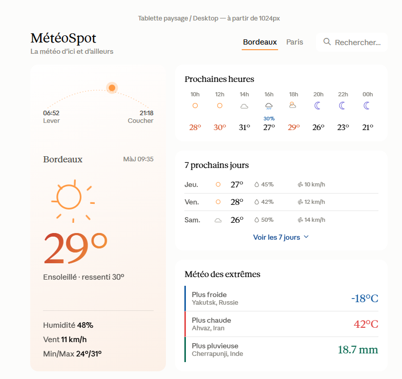

# Processus de conception — MétéoSpot

Ce document explique comment le design de MétéoSpot a été construit, en collaboration avec Claude (Anthropic), et pourquoi je n'ai pas utilisé Figma pour cette étape.

## Pourquoi pas Figma ?

La raison principale est une contrainte de temps : itérer en conversation directe avec une IA va nettement plus vite que de construire une vraie maquette Figma from scratch, tout en produisant un rendu visuel réel à chaque étape (pas une description texte).

L'avantage annexe : la boucle de rétroaction est quasi instantanée (quelques secondes entre une remarque et un nouveau rendu), et chaque décision de design est documentée dans la conversation elle-même.

## Point de départ

Le brief initial : une app météo mobile/tablette/desktop avec météo actuelle, prévisions horaires, un classement des extrêmes climatiques mondiaux, et un historique de recherche. Consigne donnée à l'IA : donner un avis honnête plutôt que complaisant, et poser des questions plutôt que deviner.

La première maquette proposée était fonctionnelle mais reconnaissable, très proche du langage visuel de nombreuses applications avec dégradé bleu et icônes génériques. Utile comme base de discussion, mais pas comme identité propre.

## Itération 1 — simplifier le scope

Plutôt que d'attaquer le visuel tout de suite, la première phase a porté sur la structure : suppression de la sidebar, du menu, de la carte, des alertes — pour ne garder que l'essentiel (météo actuelle, prévisions horaires, extrêmes, historique de recherche). Décision explicite : pas de compte utilisateur, pas de menu.

## Itération 2 — sortir du "design générique IA"

Une fois la structure posée, le retour a été clair : *"j'ai peur que ça fasse trop design d'IA"*. L'IA elle-même a identifié pourquoi — dégradés pastel par défaut, cartes toutes identiques, icônes de bibliothèques ultra-répandues (Tabler, Lucide). Plusieurs tentatives correctives ont été **explicitement rejetées** en cours de route :
- Un thème marron assumé → jugé peu adapté à une app météo.
- Un dégradé orange-corail plus vif → toujours perçu comme "une app météo grand public déjà vue".
- Des icônes redessinées à la main, trop simplistes (de simples cercles) → jugées "pas très belles".
- Une tentative de calquer le style de la bibliothèque Meteocons → écartée après avoir découvert qu'elle est déjà largement utilisée dans l'écosystème météo, donc pas si originale que ça.

La vraie rupture est venue d'un changement structurel plutôt que cosmétique : remplacement de la carte fermée classique par une composition plus éditoriale avec un arc représentant la trajectoire du soleil dans la journée (avec heures de lever/coucher), un chiffre de température qui casse la ligne d'horizon, des listes à simple barre de couleur plutôt que des blocs pleins.

## Itération 3 — un système de couleur dynamique

Plutôt qu'une palette décorative, la couleur du bloc météo principal a été reliée à la température réelle : 7 tranches (très froid à canicule), chacune avec un dégradé de texte et un fond dédiés. Deux tranches jugées trop proches visuellement (Doux/Chaud, Très chaud/Canicule) ont été retravaillées après un retour direct pour être clairement distinguables.

## Itération 4 — un vrai set d'icônes

Les icônes ont connu plusieurs versions avant validation : d'abord de simples formes géométriques (jugées trop pauvres), puis un style inspiré de la bibliothèque Skycons (formes non remplies au contour fin). Le set final compte 14 conditions météo, chacune livrée en deux versions — statique (pour les listes de prévisions) et animée en CSS (réservée au bloc météo principal, pour ne pas surcharger visuellement une liste entière d'icônes en mouvement).

## Itération 5 — typographie
Pour pousser le style éditorial de l'application, et pour se différencier des polices actuellement utilisées partout comme Roboto, il a été décidé d'utiliser une combinaison de polices dont le choix final s'est porté sur **Newsreader** (serif éditoriale) pour les éléments vedettes : nom de ville, température, titres et **Manrope** (sans-serif neutre) pour le reste.

## Itération 5 — nom
Une fois les sections et le design validés, une reflexion a été menée sur le nom et la phrase d'accroche de l'application. Le choix s'est finalement arrêté sur " **MéteoSpot**, la météo d'ici et d'ailleurs"

## Itération 7 — les cas limites

Le design a été volontairement testé sur des scénarios défavorables plutôt que sur le seul cas nominal (Bordeaux, 24°, ensoleillé) : météo très froide (Yakutsk, -18°), nom de ville long (Saint-Jean-de-la-Ruelle), et surtout des **écrans d'état**  — localisation désactivée (avec et sans historique de recherche), et échec réseau/API. Ce dernier test a révélé un vrai angle mort : la section "Météo des extrêmes" dépend de la même API que la météo actuelle, donc un échec réseau ne peut pas se contenter de masquer un seul bloc — c'est une bonne partie de la page qui doit basculer en état d'erreur.

## Itération 8 — desktop et tablette

La quasi-totalité du travail a porté sur mobile. Les versions tablette et desktop ont été abordées plus tard, avec plusieurs allers-retours sur la disposition (breakpoint corrigé de 1280px à 1024px après remarque sur les tailles d'écran réelles de laptop, plusieurs répartitions de colonnes testées et rejetées avant la version retenue : ville actuelle en pleine hauteur à gauche, prévisions et extrêmes empilés à droite). La version tablette adoptera la même disposition que la vue mobile, tandis que la disposition en desktop sera réorganisée.

## Limites assumées de cette approche

Ce processus de conception a aussi ses limites :
- tout a été validé sur des mockups statiques dans une conversation, jamais sur un vrai appareil ni dans un vrai navigateur.
- le contraste texte/fond des 7 tranches de couleur n'a pas encore été vérifié avec un outil d'accessibilité (WCAG).
- la robustesse de la mise en page desktop face à un contenu de longueur variable n'a pas été testée.
- cette direction reste elle-même une esthétique repérable du design assisté par IA du moment (fond pastel, typographie éditoriale), moins datée et moins systématiquement reconnaissable que le point de départ, mais pas une identité totalement inédite pour autant.

